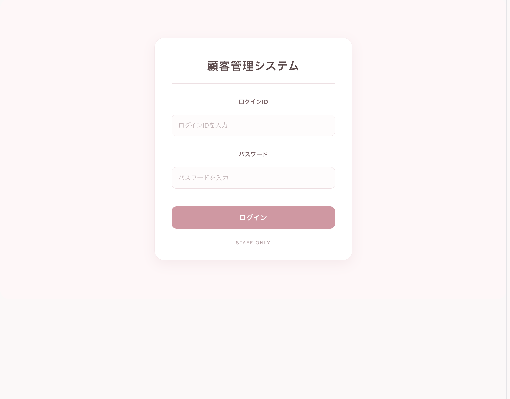
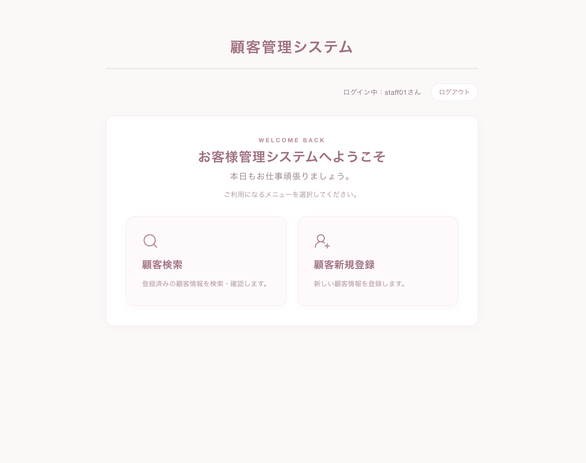
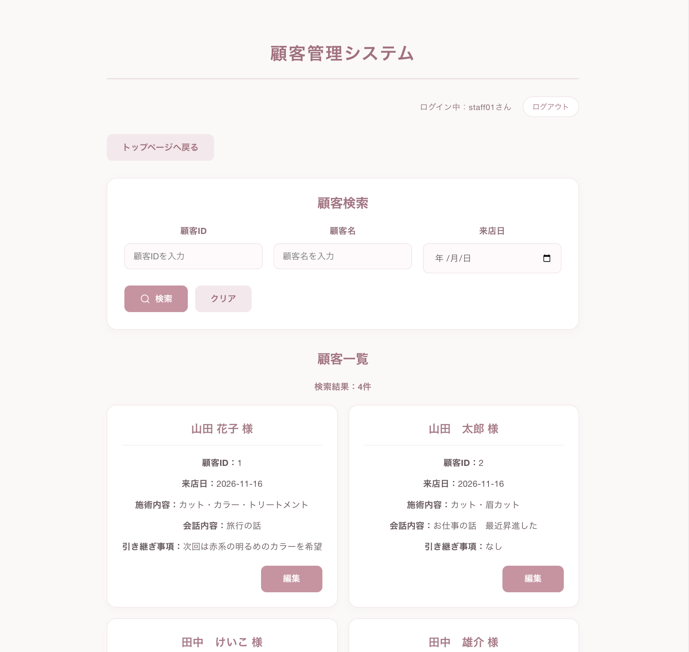
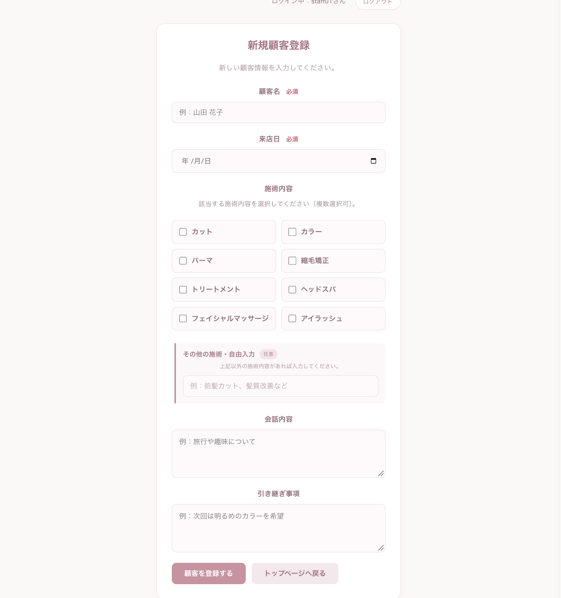
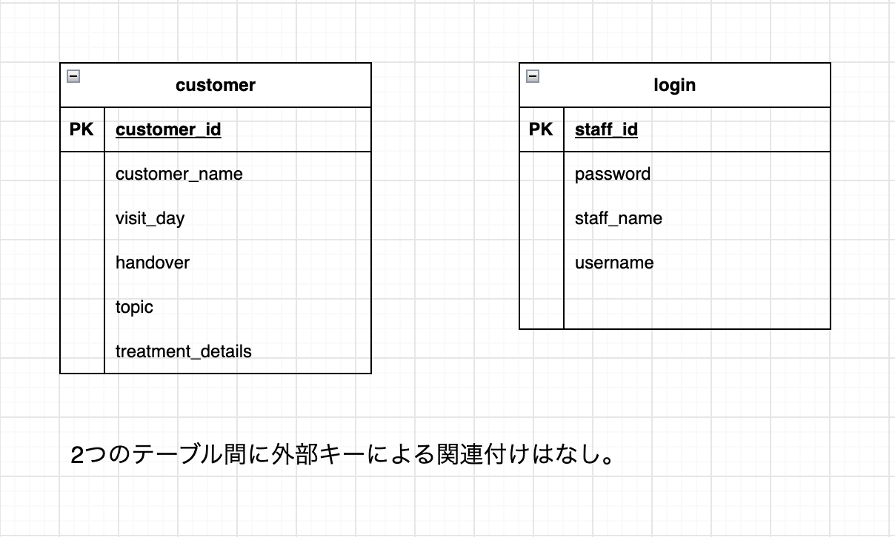

# お客様管理システムへようこそ
このアプリケーションは、毎日の接客で忙しいあなたのために、お客様情報を簡単に手軽にメモできるWEBアプリです。


## サービスへの想い
美容室やリラクゼーションサロンなど接客業に従事する方のために、その日の施術内容や会話で気になったことを短時間でメモできるアプリがあればいいと考え、制作しました。<br>
このアプリによって業務時間の短縮、次回の接客に活かすことで顧客満足度しいては売り上げ向上に繋がることを目的にしています。<br>
直感的に理解し入力しやすいようシンプルなデザインで、色彩については忙しい毎日にホッとした気分になれるような淡いピンクを基調としました。
また、講義のコードをベースに「顧客検索機能」やデザインについては自分で調べたり、AIに尋ねるなどしてオリジナリティを出すために工夫しました。


## 機能一覧
| ログインページ | トップページ |
|:---|:---|
|  | |
| ログインIDとパスワードでの認証機能を実装しました。 | 検索ページと顧客登録ページにリンクしています。 |

| 顧客検索画面 | 新規登録画面 |
|:---|:---|
|  | |
| 顧客IDや顧客名、来店日で顧客検索ができます。 | 施術内容や会話内容など手軽に直感的に入力できます。 |


## 使用技術
| Category | Technology Stack |
|:---|:---|
| Frontend | JavaSprict , React , Vite |
| Backend | Java21 , Spring Boot |
| Datebase | MySQL |
| Desingn | draw.io |
| etc. | IntelliJ IDEA , Visual Studio Code ,Git/GitHub , ChatGPT |


## ER図



# セットアップ

## 必要環境
* Java21
* Node.js / npm
* Docker Desktop
* Git

## インストール手順
1. リポジトリをクローンします。
   ```
   git clone https://github.com/Mami1234555/customer-management-app.git
   cd customer-management-app
   ```

2. プロジェクトのルートディレクトリに .env ファイルを作成します。
   ```
   touch .env
   ```
   以下の内容を設定してください。
   ```
   DB_PORT=3306
   DB_NAME=customer_db
   DB_USERNAME=app_user
   DB_PASSWORD=任意のデータベースパスワード
   DB_ROOT_PASSWORD=任意のrootパスワード
   DB_CONTAINER_NAME=customer-mysql

   ADMIN_USERNAME=staff_admin
   ADMIN_NAME=管理者
   ADMIN_PASSWORD=任意の管理者パスワード
   STAFF_PASSWORD=任意のスタッフパスワード
   ```
   ※ パスワードは任意の安全な値を設定してください。


3. Docker Composeを使用してMySQLコンテナを起動します。
   ```
   docker compose up -d
   ```
   コンテナの起動状態を確認します。
   ```
   docker compose ps
   ```

4. 別のターミナルを開き、以下を実行します。
   ```
   cd customer-management-app/backend
   ./mvnw spring-boot:run
   ```
   バックエンドは以下のURLで起動します。

   http://localhost:8080


5. さらに別のターミナルを開き、以下を実行します。
   ```
   cd customer-management-app/frontend
   npm install
   npm run dev
   ```

6. ブラウザで以下のURLにアクセスします。

   http://localhost:5173

   ログイン画面が表示されたらセットアップ完了です。
